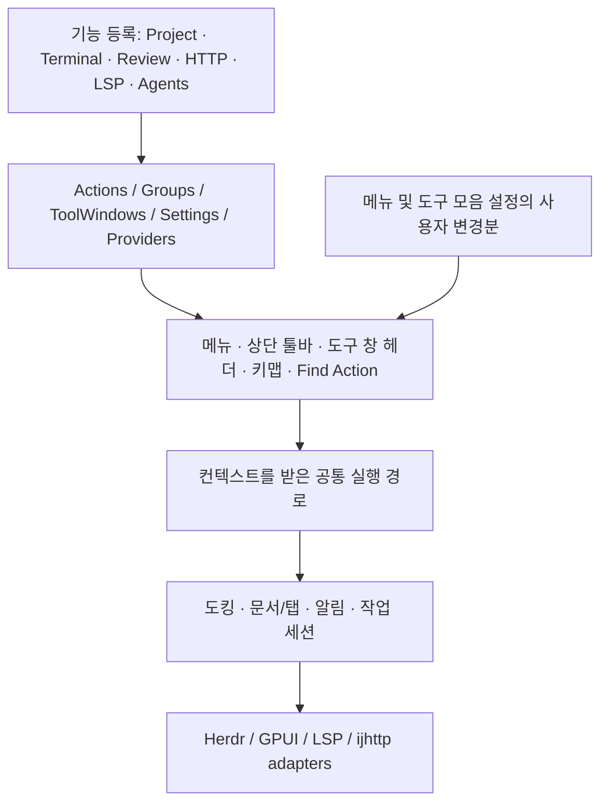

# Herdr IDE 플랫폼 구조 전환

2026-11-04. 상태: **현재 기능 조사·IDEA 구조 추출·Herdr 이식 설계 완료, 플랫폼 리팩터링은 미착수**.

사용자에게는 하나의 IDE로 보이고, 내부에서는 기능을 등록해서 확장하는 모드로 만든다.
현재 공통 디자인 시스템을 유지하면서 **액션 → 메뉴/툴바 → 도구 창 → 문서/편집기 → 기능 provider** 순서로 구조를 바꾼다.
개별 화면을 계속 복제하는 방식에서 벗어나는 것이 이번 변경의 목적이다.

## 이번에 만든 자료

| 자료 | 내용 |
| --- | --- |
| [현재 구현과 필요한 것](01-current-state.md) | 기존 8개 도구 창, 툴바·설정·키맵·편집기·진단·알림·드래그의 실제 상태와 부족한 공통 구조 |
| [IDEA 조사 결과](02-idea-findings.md) | 설치된 2026.2.4의 bytecode/XML·실제 설정 화면·공식 문서에서 확인한 구조, 근거와 한계 |
| [Herdr 설계](03-architecture.md) | registry, action context, 사용자 커스텀, 도킹·문서 상태, 설정 트리, 엔진 경계 |
| [구현 순서와 완료 조건](04-roadmap.md) | 선행 작업과 후속 요청을 빠뜨리지 않는 단계별 전환·검증 계획 |
| [IDEA 그룹 추출 데이터](evidence/idea-structure.json) | 3개 리소스의 선택 그룹 98개와 관련 add-to-group 선언 24개; 전체 런타임 registry가 아님 |
| [정적 분석 근거](evidence/static/README.md) | 9개 클래스의 관련 bytecode 발췌·해시·재현 스크립트 |
| [REA 기록](evidence/rea-session.json) | 앱 identity Evidence와 JAR inventory 실패 기록 |

## 선정한 형태



가장 먼저 만들 사용자 기능은 **설정 → 모양 및 동작 → 메뉴 및 도구 모음**이다.
상단의 왼쪽·가운데·오른쪽 그룹과 Project/Structure/Problems 등의 메뉴를 같은 트리에서
추가·제거·이동·복원한다. 도구 창의 위치·활성·분할은 별도의 도킹 모델이 소유한다.
툴바 항목 편집과 도구 창 배치를 같은 배열로 취급하지 않는다.

이 단계에서는 연구용 추출기와 문서만 추가했다. 이전 요청의 미커밋 구현을 보존했으며,
설치된 Herdr를 갱신하거나 IDEA 설정에 Apply하지 않았다. 앞선 UI 작업이 모두 검증·완료되었다는 뜻은 아니다.

## 다시 조사하기

```sh
python3 design/idea/extract_structure.py --output /tmp/idea-structure.json
python3 docs/workflows/ide-platform/evidence/static/extract_structure.py --output /tmp/idea-structure-bytecode
```

첫 명령은 클래스 실행 없이 XML 구조와 정확한 앱/JAR identity를 추출한다.
둘째는 설치된 JDK의 javap으로 관련 bytecode를 발췌한다. 결과는 연구 자료이며
Herdr에 자동 적용하지 않는다. 앱 업데이트 시 해시·빌드·실제 UI를 다시 비교한다.

기존 [시각 정합 계획](../../../design/idea/PARITY_PLAN.md)과
[컴포넌트 계약](../../../design/idea/COMPONENTS.md)은 계속 적용한다.
이 문서는 그 위에 추가할 **동작·상태·확장 구조**를 정의한다.

## 이번 산출물 검증

- 구조 추출을 다시 실행해 저장된 JSON과 전체 일치 확인, JAR 전후 해시 일치, 3방향 툴바 그룹·기여 선언 검사 통과.
- 문서의 로컬 링크 검사와 `git diff --check` 통과.
- 기존 `sync_ui.py --check`, `check_system.mjs`, `check_shortcuts.mjs` 통과. 새 플랫폼 UI를 검증한 결과는 아님.
- 독립 소스 검토에서 지적한 미저장 문서 수명과 기존 전역 배치의 workspace 승계 조건을 설계·완료 조건에 반영.
- REA 분석 세션 종료. IDEA 설정 Apply 없이 Cancel로 복귀. 도구 창 이동 메뉴의 후속 Computer Use 조회는 timeout으로 미확인.
